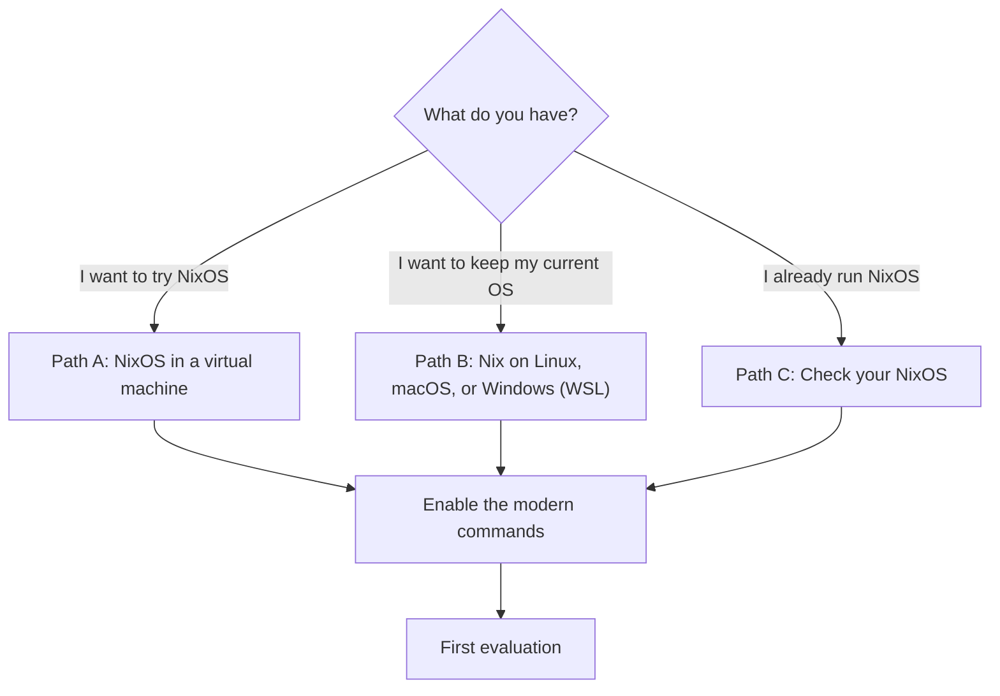

import { Aside, Steps, Tabs, TabItem } from '@astrojs/starlight/components';

This page gets you from **nothing installed** to a setup where you can type a
Nix expression and see what it evaluates to. Every step ends with a command
that proves it worked.

## Four names, quickly

| Name | What it is |
|------|------------|
| **Nix** (the language) | A small language for describing packages and configuration. |
| **Nix** (the tool) | The program that evaluates that language and builds things. Runs on Linux and macOS. |
| **Nixpkgs** | The huge collection of packages written in the Nix language. |
| **NixOS** | A Linux distribution whose whole system is configured with Nix. |

You can use Nix without NixOS. You cannot use NixOS without Nix.

## Pick your path



<Tabs>
<TabItem label="A: Try NixOS">

The safest way to try NixOS on a desktop is a **virtual machine (VM)**. Nothing
on your computer changes, and you can delete it at any time.

<Steps>

1. Download the **Graphical ISO image** from
   [nixos.org/download](%%nixos-download-iso%%).

2. Create a VM from the ISO with any VM app you already have, for example
   GNOME Boxes or virt-manager on Linux, or VirtualBox.

3. Boot the VM. The live desktop lets you look around before installing.

4. Run the graphical installer and follow the NixOS manual:
   [Graphical installation](%%nixos-manual-install-graphical%%).

5. After rebooting into the installed system, open a terminal and run:

   ```sh
   nixos-version
   ```

   You should see a version number followed by a release name, for example
   `%%nixos-release%%.…`. That proves you are on NixOS.

</Steps>

<Aside>
Ready to install on real hardware? The same ISO works from a USB stick. See
[Booting from a USB flash drive](%%nixos-manual-boot-usb%%).
</Aside>

</TabItem>
<TabItem label="B: Nix on my current OS">

Nix installs next to your existing system. Your distribution and apps keep
working as before.

<Tabs>
<TabItem label="Linux">

Recommended multi-user install (systemd, SELinux disabled, and `sudo` access):

```sh
%%nix-install-cmd-linux%%
```

</TabItem>
<TabItem label="macOS">

Requires macOS %%nix-install-macos-min%% or newer. In Terminal:

```sh
%%nix-install-cmd-macos%%
```

</TabItem>
<TabItem label="Windows">

Use WSL2 with systemd enabled, then run the Linux command inside it:

```sh
%%nix-install-cmd-linux%%
```

Want full NixOS on Windows instead? See
[NixOS-WSL](%%nixos-wsl%%).

</TabItem>
</Tabs>

Then **close and reopen your terminal** so it picks up Nix, and run:

```sh
nix --version
```

You should see something like `nix (Nix) 2.x.y`.

Commands, options, and other platforms are listed on
[nixos.org/download](%%nixos-download%%). To remove Nix later, see
[Uninstalling Nix](%%nix-manual-uninstall%%).

</TabItem>
<TabItem label="C: I already run NixOS">

Check your version:

```sh
nixos-version
```

Your whole system is described by files in `/etc/nixos/`. The main one is
`/etc/nixos/configuration.nix`. You will change it in the next step.

</TabItem>
</Tabs>

## Enable the modern commands

Nix has two sets of commands:

- **Classic commands** like `nix-instantiate`, `nix-build`, `nix-shell`.
  They always work.
- **Modern commands** like `nix eval`, `nix build`, `nix develop`, and
  **flakes**. They are still marked *experimental*, so they are **off** after
  a fresh install.

Most current guides and videos, including this site, use the modern commands.
Turn them on once:

<Tabs>
<TabItem label="Nix on Linux / macOS / WSL">

Add this line to `~/.config/nix/nix.conf` (create the file if it does not
exist):

```ini
experimental-features = nix-command flakes
```

</TabItem>
<TabItem label="NixOS">

Add this line inside the `{ … }` of `/etc/nixos/configuration.nix`:

```nix
nix.settings.experimental-features = [ "nix-command" "flakes" ];
```

Then apply it:

```sh
sudo nixos-rebuild switch
```

</TabItem>
</Tabs>

**Verify it:**

```sh
nix config show experimental-features
```

The output must include `flakes` and `nix-command`. If you see
`experimental Nix feature 'nix-command' is disabled` anywhere, this step did
not take effect.

See [experimental features](%%nix-manual-experimental-features%%)
in the Nix manual for what each feature does.

## Your first evaluation

Everything in Nix starts with **evaluation**: Nix reads an expression and
computes its value. Two ways to see that happen:

**One-shot**, with a classic command (works even before the previous step):

```sh
nix-instantiate --eval --expr '1 + 1'
```

Output:

```
2
```

**Interactive**, with the REPL (Read–Eval–Print Loop):

```sh
nix repl
```

Type an expression and press Enter. Nix prints its value. Type `:q` to quit.

```
nix-repl> 1 + 1
2
```

If both print `2`, you are set up. The REPL is the main tool on this site
for **seeing what Nix sees** instead of guessing.

## Next

This page and the next two are the **foundations**, the same for everyone.
After them, you pick a track: [NixOS](/nixos/) or
[Nix on another distro / WSL](/other-distro/).

- [Seeing what Nix sees](/seeing-what-nix-sees/): the commands that show you
  what any Nix code evaluates to.
- [How examples are verified](/about/verified-examples/): try your first
  real example file.
